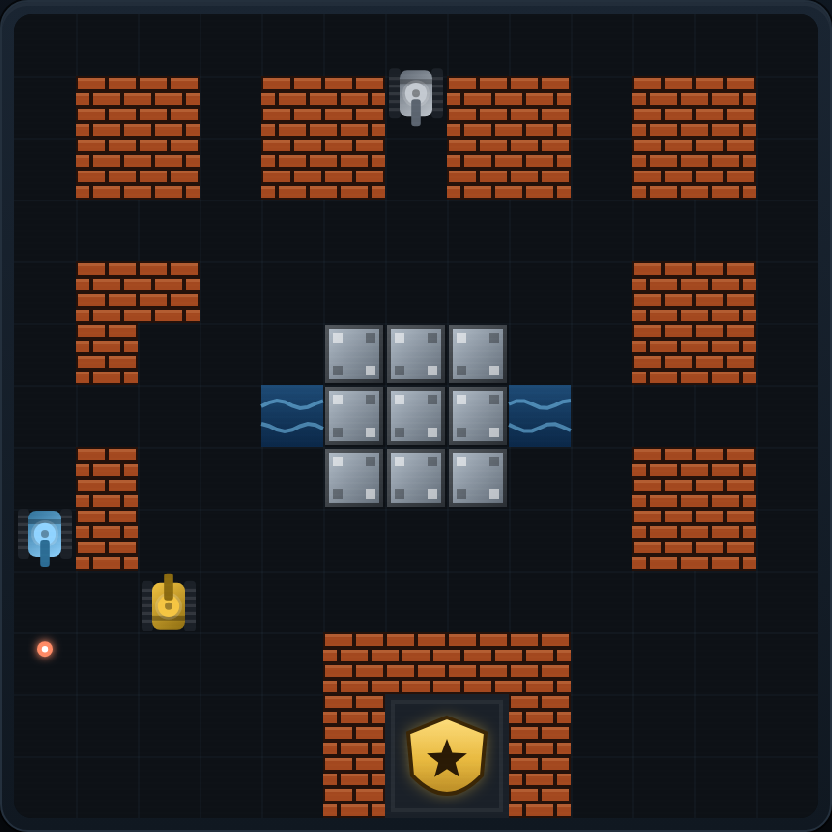

<div align="center">

# 🎮 坦克大战 · Tank Battle

经典 Battle City 风格的 HTML5 坦克大战 —— 纯 Canvas 实现，零依赖，打开即玩。

[在线试玩](https://andrew56700.github.io/tank-battle/) · [功能](#-功能) · [操作](#-操作) · [本地运行](#-本地运行)

</div>



## ✨ 功能

- **4 张手工设计的地图**，每关循环并逐步提升难度，敌人越打越凶
- **4 种敌方坦克**：普通、快速、重型火力、装甲（3 点血，受击变色）
- **5 种道具**：★ 火力升级、♥ 加命、● 全屏清敌、⏱ 冻结敌人、⛨ 护盾
- **可破坏地形**：砖墙可被打穿，钢墙需三级火力，水面阻挡坦克，树林可以隐蔽
- **敌方 AI**：会主动追击玩家、优先扑向基地，被卡住时自动转向
- **完整流程**：计分、最高分记录、生命、关卡结算、暂停、重新开始
- **键鼠 + 触屏**：手机端自动显示虚拟方向键与开火键
- **合成音效**：WebAudio 实时生成，无需音频文件，可一键静音
- **零依赖**：没有框架、没有构建步骤、没有网络请求

## 🕹 操作

| 操作 | 按键 |
| --- | --- |
| 移动 | `↑` `↓` `←` `→` 或 `W` `A` `S` `D` |
| 开火 | `空格` / `J` / `K` |
| 暂停 | `P` / `Esc` |
| 静音 | `M` |
| 开始 / 继续 | `Enter` 或点击按钮 |

手机 / 平板：使用屏幕下方的虚拟方向键与「开火」按钮。

## 🎯 玩法

守住屏幕底部的金色基地，消灭本关全部敌方坦克即可过关。基地被击毁或生命耗尽则游戏结束。

| 敌人 | 特点 | 分数 |
| --- | --- | --- |
| 银灰色 · 普通 | 速度一般，数量最多 | 100 |
| 蓝色 · 快速 | 移动速度快 | 200 |
| 橙色 · 重型 | 炮弹速度更快 | 300 |
| 红色 · 装甲 | 需命中 3 次才能击毁 | 400 |

每第 4 辆敌人带有红色闪烁边框，击毁后会掉落随机道具。拾取道具还能获得额外分数。

| 道具 | 效果 |
| --- | --- |
| ★ 星 | 火力升级（Lv.1 → Lv.3）。Lv.2 可同时发射 2 发、弹速更快；Lv.3 炮弹可击穿钢墙 |
| ♥ 心 | 生命 +1 |
| ● 炸弹 | 立即摧毁场上所有敌人 |
| ⏱ 时钟 | 冻结所有敌人 6 秒 |
| ⛨ 护盾 | 获得 8 秒无敌护盾 |

## 🚀 本地运行

项目是纯静态页面，不需要安装任何依赖。直接用浏览器打开 `index.html` 即可。

也可以起一个本地静态服务器：

```bash
# Python 3
python -m http.server 8080

# 或 Node.js
npx serve .
```

然后访问 <http://localhost:8080>。

## 📁 项目结构

```
.
├── index.html      # 页面结构、HUD 与覆盖层
├── style.css       # 街机风格样式与移动端适配
├── game.js         # 游戏逻辑、AI、渲染、音效
├── screenshot.png  # 游戏截图
└── README.md
```

## 🌐 部署

已托管在 GitHub Pages，直接访问 [在线试玩](https://andrew56700.github.io/tank-battle/)。

自行部署：在仓库 **Settings → Pages** 中选择 `Deploy from a branch`，分支选 `main`、目录选 `/ (root)` 即可。

## 📄 License

[MIT](LICENSE)
